# 用 Mermaid 重現 draw.io 元件

匯出日期：2026-11-05（Asia/Taipei）

本檔保存本次匯出前的使用者訊息、Codex 回答與進度訊息，依時間排序；不含工具執行紀錄或內部推理。附件保存在 `chat-assets`。歷史回答依原文保留，未重新校訂。

---

## 1. 你

你可以使用mermaid還重現這個drawio 元件嗎?

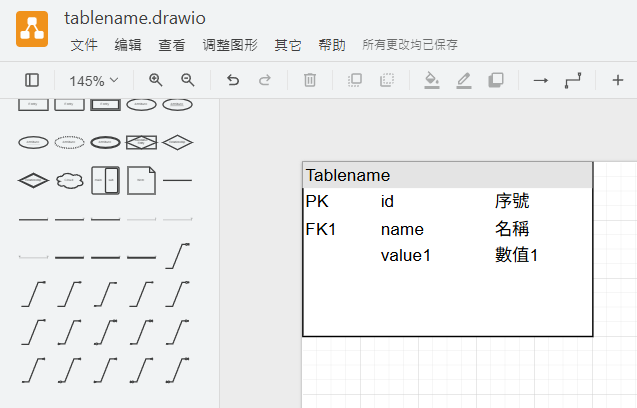

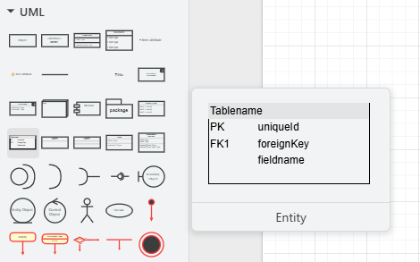

---

## 2. Codex

可以，用 Mermaid 的 `erDiagram` 最接近這個 Entity 元件，能呈現表名、欄位、主鍵／外鍵及中文說明：

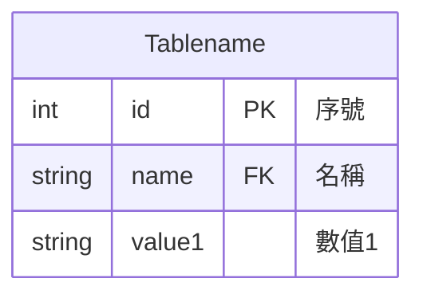

不過 Mermaid 的欄位排列固定為「型別 → 欄位名稱 → 鍵 → 說明」，無法完全重現圖片中的「PK/FK → 欄位名稱 → 中文說明」。表頭、欄寬與留白也由 Mermaid 自動配置。

如果你要求**外觀與圖片一致**，就需要使用 HTML／SVG；若重點是資料表結構，上面的 Mermaid 即可。

---

## 3. 你

不要使用HTML／SVG，我需要人工能修改，人類能閱讀，AI可用最低Token繪製

---

## 4. Codex

建議用 Mermaid 的 `classDiagram`，省略資料型別，文字少、容易手改，也能保留表頭與欄位區：

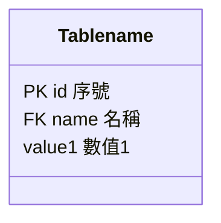

每行就是一個欄位，直接修改即可。外觀接近原圖，但無法精確控制三欄對齊。

---

## 5. 你

請你在你工作目錄建立一個讓我看看這個檔案我電腦閱讀起來是長怎麼樣。請使用`erDiagram`  ，因為排版還好，但功能很重要，還有行列鎖定也很重要

---

## 6. Codex（進度訊息）

我會在工作目錄建立 Mermaid 檔，使用 `erDiagram` 保留主鍵、外鍵與欄位說明，並附上可直接閱讀的 Markdown 版本。

---

## 7. Codex

已建立，點擊即可查看：

- [Markdown 預覽檔](C:/Users/wills/OneDrive/文件/ChatGPT/mermiad工廠/tablename.md)
- [Mermaid 原始檔](C:/Users/wills/OneDrive/文件/ChatGPT/mermiad工廠/tablename.mmd)

使用 `erDiagram`，保留 PK、FK、中文說明與欄位順序。

「行列鎖定」若指固定欄位順序與各欄意義，可以；若指捲動時凍結表頭、鎖定欄寬或位置，Mermaid 本身不支援。

---

## 8. 你

這是最省Token的畫ER圖的方法嗎?

---

## 9. Codex

**在需要保留型別、PK／FK、中文說明，而且使用 Mermaid 的前提下，目前寫法已經很精簡。** 空白與縮排還能減少，但不一定會明顯降低 Token，卻會降低可讀性。

建議保留這種格式：


要再省，主要得減少內容，例如省略中文說明；`erDiagram` 的每個欄位仍需要「型別＋名稱」。

另外，目前只有資料表結構。若要表達表與表之間的關聯，還要增加一行，例如：

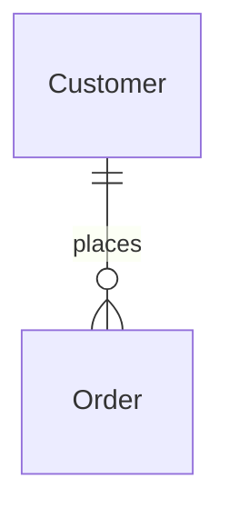

這種「一行一個欄位、一行一個關聯」的寫法，是兼顧人工修改、AI 產生與 Token 用量的實用選擇。

---

## 10. 你

> 引用先前回答：「可以，用 Mermaid 的 erDiagram 最接近這個 Entity 元件，能呈現表名、欄位、主鍵／外鍵及中文說明：」

那麼畫一個標準又稍為複雜的ER圖吧，讓我看看，擬就照這個測試圖去做。

---

## 11. Codex（進度訊息）

我會沿用測試圖的格式，建立訂單系統 ER 圖，加入多表關聯、複合主鍵與可選關係，讓你查看較完整的效果。

---

## 12. Codex

已依照原本 Entity 測試圖的格式，建立 **8 張表的訂單系統 ER 圖**。

- [開啟 ER 圖預覽](C:/Users/wills/OneDrive/文件/ChatGPT/mermiad工廠/order-system.md)
- [開啟 Mermaid 原始檔](C:/Users/wills/OneDrive/文件/ChatGPT/mermiad工廠/order-system.mmd)

包含客戶、地址、訂單、訂單明細、商品、分類、付款及出貨，展示：

- 主鍵、外鍵、唯一鍵與複合主鍵。
- 一對多、可選關聯及識別關聯。
- 多次付款、分批出貨與歷史成交單價。

每行一個欄位或關聯，方便人工修改，也能維持精簡。

---

## 13. 你

我其實是業餘的ER圖工作者，我其實都不懂這些線的意思，請你列舉圖解告訴我這些線、箭頭的意思

---

## 14. Codex

可以。ER 圖的線主要告訴你：**一筆資料，能對應到另一張表的幾筆資料。** 這些線端符號通常不是箭頭，沒有流程方向。

先記住這三個符號：

| 符號 | 外觀概念 | 意思 |
|---|---|---|
| `o` | 圓圈 | 可以是零筆，也就是可以沒有 |
| `|` | 直線 | 一筆 |
| `{` 或 `}` | 像鳥腳分岔 | 多筆 |

線的每一端會把符號組合起來，表達「最少幾筆、最多幾筆」：

| Mermaid 寫法（右端） | 意思 | 白話 |
|---|---|---|
| `||` | 一到一 | 必須有，而且只能一筆 |
| `o|` | 零到一 | 可以沒有，最多一筆 |
| `o{` | 零到多 | 可以沒有，也可以很多筆 |
| `|{` | 一到多 | 至少一筆，可以很多筆 |

左端的符號會左右鏡像，例如 `|o`、`}o`，意思相同。

### 1. 一對多，而且可以沒有：客戶與訂單

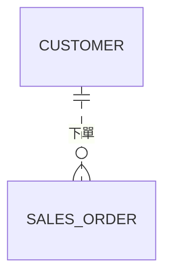

讀法：

- **一位客戶**可以有 **零筆到多筆訂單**，因為新註冊的客戶可能還沒下單。
- **一筆訂單**必須屬於 **恰好一位客戶**。

**讀客戶有幾筆訂單，就看「訂單那一端」的符號。** 反過來，讀訂單屬於幾位客戶，就看客戶端。這是最重要的閱讀技巧。

### 2. 一對多，而且至少一筆：訂單與明細

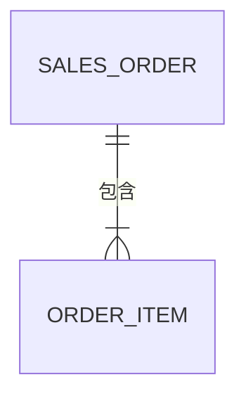

讀法：

- 一筆訂單必須包含 **一筆到多筆明細**。
- 一筆明細必須屬於 **恰好一筆訂單**。

例如：

```text
訂單 A
  ├─ 第 1 項：鍵盤 × 1
  └─ 第 2 項：滑鼠 × 2
```

這個模型規定訂單不能沒有明細。

### 3. 零或一：訂單與配送地址

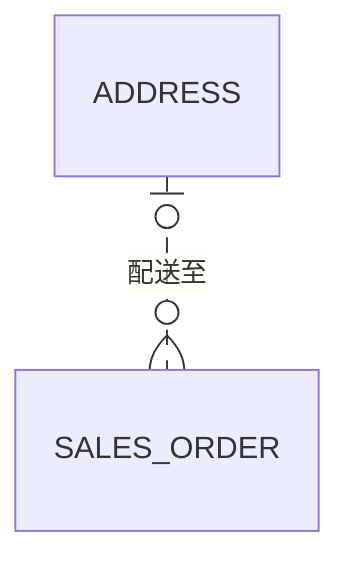

讀法：

- 一筆訂單可以沒有配送地址，或使用 **一個地址**，例如數位商品不需要配送。
- 一個地址可以被 **零筆到多筆訂單**使用。

這裡地址旁的 `o|`，表示「每筆訂單對應零或一個地址」。

### 4. 一對一：人員與員工資料

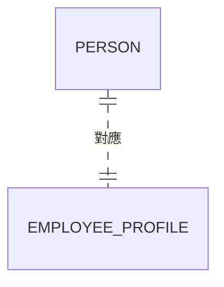

讀法：

- 每位人員必須有 **恰好一份員工資料**。
- 每份員工資料必須屬於 **恰好一位人員**。

這是一個嚴格的一對一模型；如果有人尚未建立員工資料，就應把員工資料那端改成 `o|`。

### 5. 多對多：學生與課程

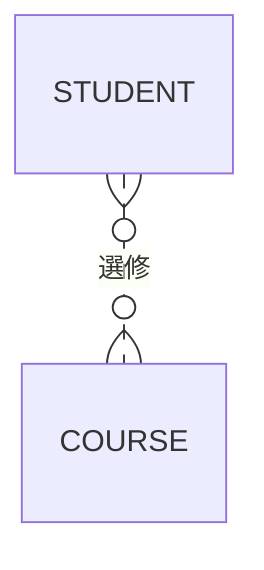

讀法：

- 一位學生可以選 **零到多門課**。
- 一門課可以有 **零到多位學生**。

實際設計關聯式資料庫時，通常會加入「選課紀錄」表：

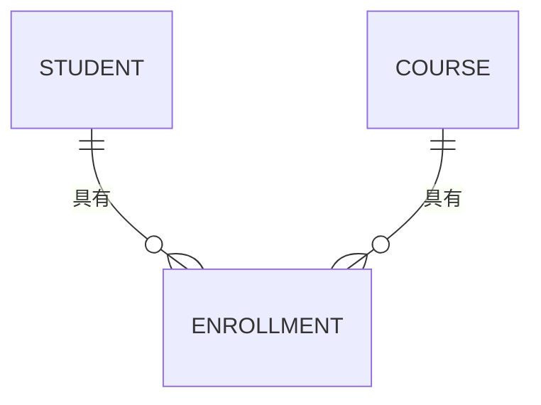

每筆選課紀錄連接一位學生和一門課。這樣也能記錄選課日期、成績等資訊。

### 6. 實線和虛線：主鍵是否包含父表的鍵

**實線與虛線不表示必填或選填**；是否可以沒有，要看端點的圓圈。

| 線條 | Mermaid 寫法 | 意思 |
|---|---|---|
| 實線 | `--` | 識別關聯：父表的鍵成為子表主鍵的一部分 |
| 虛線 | `..` | 非識別關聯：子表有外鍵，但這個外鍵不是其主鍵的一部分 |

看這個簡化例子：

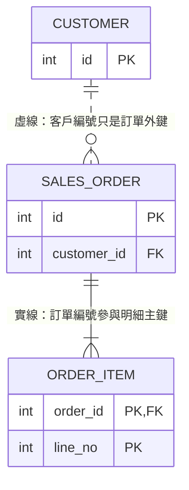

- **訂單明細**靠「訂單編號＋項次」辨認，因此連訂單的是實線。
- **訂單**靠自己的 `id` 辨認，`customer_id` 只是外鍵，因此連客戶的是虛線。

你剛開始畫圖時，可以依序問：**能不能沒有？最多一筆還是多筆？外鍵有沒有參與主鍵？** 這三題就能決定端點和線條。

---

## 15. 你

所以畫ER圖時一定是一個PK對一個FK?

---

## 16. Codex

不一定。比較準確的說法是：**兩張表建立關聯時，通常由一邊的 PK（主鍵），對應另一邊的 FK（外鍵），但不代表資料是一對一。**

例如，一位客戶有三筆訂單：

```text
客戶表                     訂單表
id（PK）                   id（PK）  customer_id（FK）
1 王小明                   101       1
                           102       1
                           103       1
```

這裡同一個 PK 值 `1`，被三筆訂單的 FK 引用，因此是**一對多**：


另外有三個例外要知道：

| 情況 | 說明 |
|---|---|
| 引用唯一鍵 | FK 也可以引用符合資料庫要求的唯一鍵（UK），不一定是 PK |
| 複合鍵 | 可能用兩個以上欄位一起對應，例如「訂單編號＋項次」 |
| 概念圖 | ER 圖可以先畫實體與關係，不必立刻列出 PK、FK |

所以要分開看：**PK／FK 表示資料如何連接；線端的符號表示可以連接幾筆。**

---

## 17. 你

我可以將我們這個對話框存起來變成一個文字檔嗎?或HTML?

---

## 18. Codex（進度訊息）

我先確認這個聊天是否能直接匯出，以及能保留哪些內容。

---

## 19. Codex（進度訊息）

我使用 OpenAI Docs 技能確認匯出方式；另外，也可以將目前對話內容整理成一般檔案。

---

## 20. Codex

可以，可以把我們的問答存成以下格式：

| 格式 | 適合用途 | ER 圖如何呈現 |
|---|---|---|
| `.txt` | 最單純的文字備份 | 保留 Mermaid 原始碼 |
| `.md` | 方便人工修改、讓 AI 接續閱讀 | 支援 Mermaid 的閱讀器可顯示圖 |
| `.html` | 用瀏覽器閱讀，保留標題、表格與排版 | 加入 Mermaid 渲染程式即可顯示圖 |

**你的用途最適合保存 `.md`，另附 `.html` 閱讀版**：前者方便修改，後者方便觀看。HTML 只是對話的閱讀容器，ER 圖來源仍然是 Mermaid。

我可以將目前可見的問答依順序存到工作目錄，並標示「你／我」。這會是對話內容整理；目前我未確認這個 App 是否提供完整聊天的一鍵匯出功能。

---

## 21. 你

我說我們這個CODEX對話框

---

## 22. Codex

了解，你指的是 **Codex App 裡我們正在使用的整個聊天視窗**。

我目前沒有確認到它是否有「匯出整段聊天為 TXT／HTML」的內建按鈕，不能直接告訴你有。

可以確定的替代方式是：**由我將這段聊天中的使用者訊息與回答，依序寫成 `.txt` 或 `.html` 檔案**。這是保存聊天內容，無法完整複製 Codex 視窗本身的介面與互動功能。

---

## 23. 你

請幫我把這個對話存成`.md`，另附 `.html`

---

## 24. Codex（進度訊息）

我會把目前這段聊天的問答依序存成 Markdown，另做一份可用瀏覽器開啟的 HTML，保留 Mermaid 原始碼與圖表顯示功能。

---
