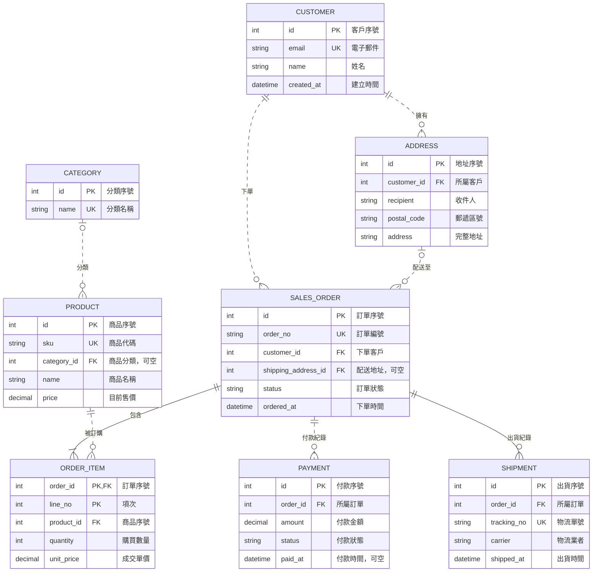

# 訂單系統 ER 圖

沿用測試圖的「表名、型別、欄位、鍵、中文說明」格式，展示 8 張資料表。

## 閱讀方式

- `PK`：主鍵；`FK`：外鍵；`UK`：唯一鍵。
- `||`：恰好一筆；`o|`：零或一筆；`o{`：零到多筆；`|{`：一到多筆。
- 實線表示識別關聯，虛線表示非識別關聯；是否識別取決於父表鍵是否構成子表主鍵。
- 訂單明細以 `order_id + line_no` 作為複合主鍵，同一訂單可在不同項次包含相同商品。
- 訂單至少包含一筆明細；可有多次付款及分批出貨。
- 配送地址與商品分類可空，因此訂單可沒有配送地址，商品可沒有分類。
- 明細保存成交單價，商品售價變動不會改變歷史訂單。

## 修改與限制

每行一個欄位，每行一個關聯。欄位依原始碼順序呈現；圖形位置由 Mermaid 自動配置。型別為示範用通用名稱。

這是資料模型圖，不會建立資料庫或執行約束。訂單至少一筆明細、配送地址須屬於下單客戶等規則，需要資料庫或應用程式另外實作。圖中出貨僅記錄訂單層級，未細分各批出貨的商品數量。

獨立來源檔為 `order-system.mmd`；修改本檔或來源檔時，另一份需同步更新。

