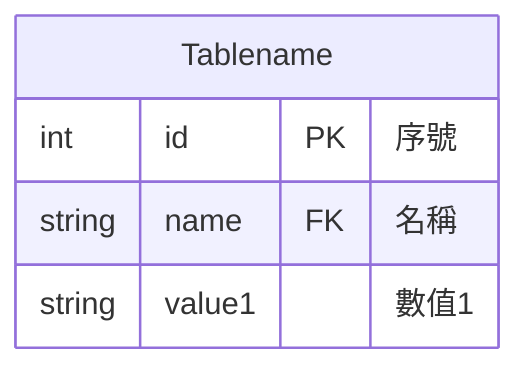

# 資料表預覽

以下區塊可在支援 Mermaid 的 Markdown 閱讀器中顯示為資料表圖。

## 修改方式

- `Tablename`：資料表名稱。
- 每一行代表一個欄位，順序為「型別、欄位名稱、鍵、說明」。
- `PK` 是主鍵、`FK` 是外鍵；一般欄位省略鍵標記。
- 雙引號內是中文說明；型別目前為示範值，可依實際資料修改。
- `tablename.mmd` 是可獨立編輯的 Mermaid 原始檔；本檔的圖表區塊與它內容相同，修改時請同步。

## 行列固定的範圍

`erDiagram` 會依原始碼順序顯示欄位，各欄固定對應型別、名稱、鍵與說明，適合維持一致的資料表結構。

Mermaid 不提供試算表式的凍結列／欄，也無法鎖定欄寬、列高或圖形座標。若「行列鎖定」指捲動時固定表頭，需由閱讀器提供，這兩個檔案本身無法設定。
